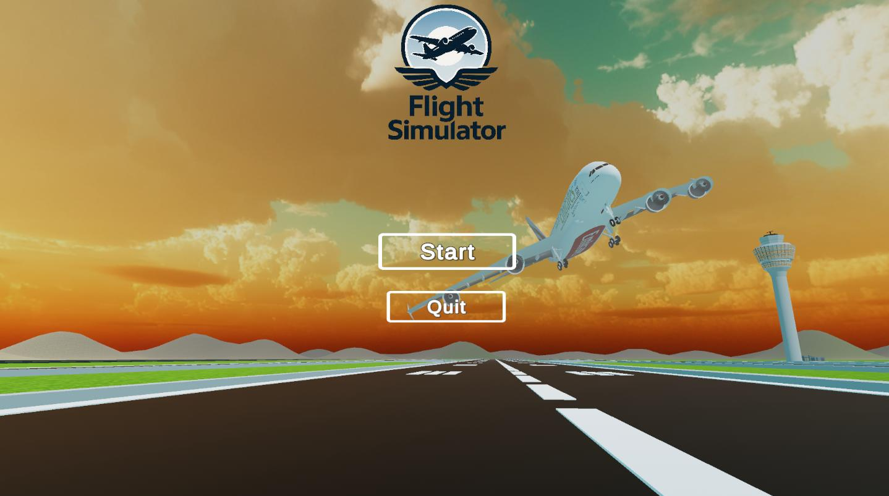
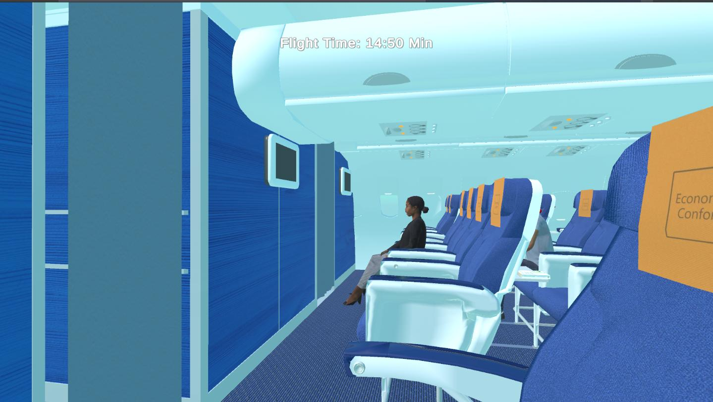
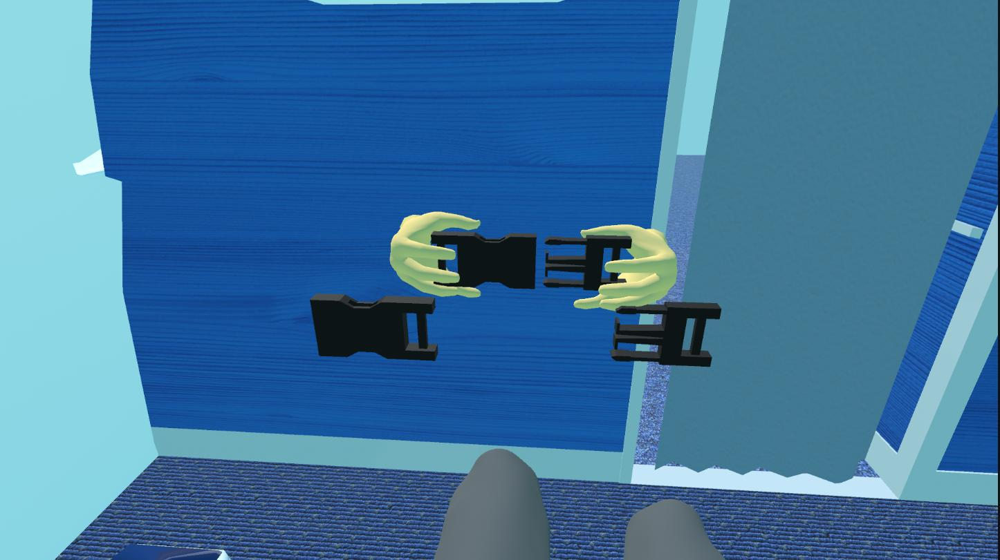
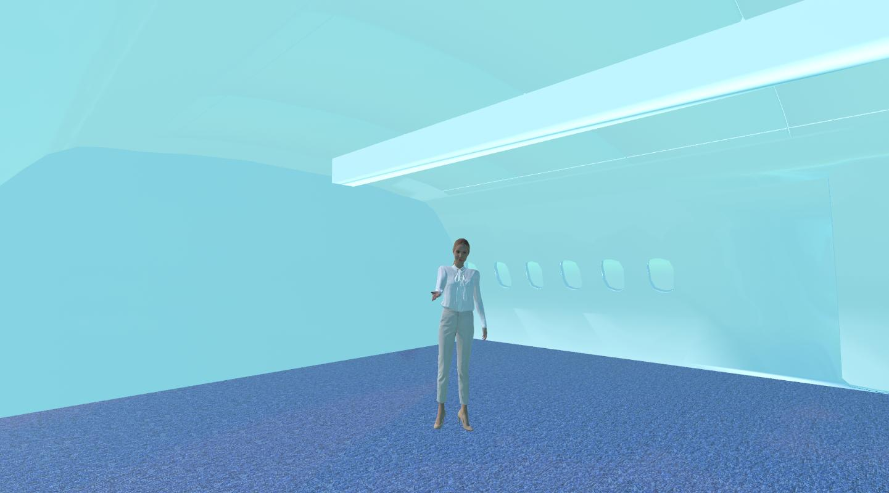
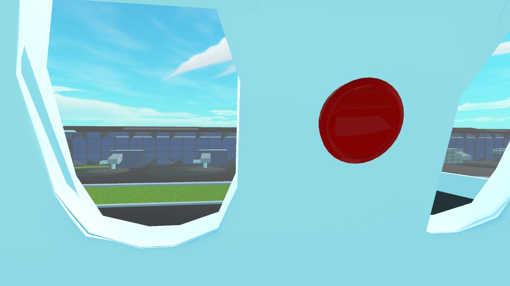

# Flight Simulator — VR Experience

An interactive flight simulation developed in Unity using C#, with support for both VR and PC.

**[View Project on itch.io](https://yairweizman.itch.io/flight-simulator-vr)**

## Overview

A passenger-focused flight simulation designed to recreate the experience of traveling on an airplane.

The project combines an interactive aircraft environment, VR interactions, and a complete flight sequence from boarding to landing.

## Features

- **VR & PC Support:** Separate player controls for VR and desktop.
- **Interactive Environment:** Airplane cabin interactions, including seatbelts, window shades, and passenger seating.
- **Flight Simulation:** Flight stages covering boarding, takeoff, in-flight experience, and landing.
- **Difficulty Levels:** Different environmental conditions and flight durations based on the selected difficulty.
- **Flight Experience Tracking:** Session timing and end-of-flight feedback.
- **Immersive Audio:** Aircraft sounds, announcements, and environmental effects.

## Tech Stack

- **Language:** C#
- **Engine:** Unity 2022.3 LTS
- **VR:** XR Interaction Toolkit
- **Architecture:** Object-Oriented Programming, Component-Based Design

## Screenshots

### Main Menu

### Inside the Airplane

### VR Interaction Buckle Up!

### Flight Attendant

### Flight View

## Running the Project

1. Clone the repository.
2. Open the project in Unity Hub using Unity 2022.3.35f1.
3. Open `Assets/Scenes/MainMenuScene.unity`.
4. Enter Play Mode.

VR functionality requires a compatible headset and the appropriate XR configuration.
